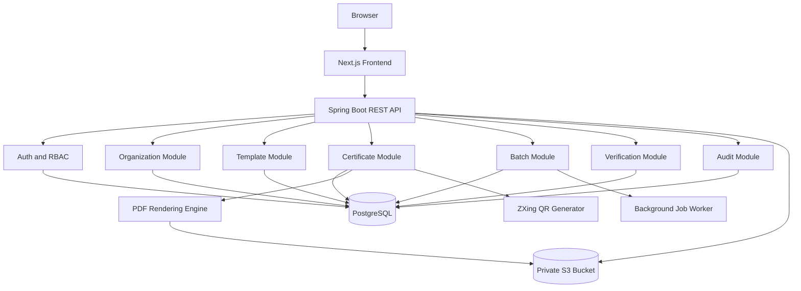

# System Architecture

## 1. Architecture style

Use a modular monolith for the first release. Keep clear module boundaries in Spring Boot; do not introduce microservices until operational scale or team structure justifies them.

## 2. High-level components

## 3. Frontend

- Next.js App Router and TypeScript.
- Feature-oriented modules.
- Fabric.js editor isolated from ordinary page components.
- Zustand stores for editor state and transient UI state.
- React Hook Form + Zod for forms.
- API client with typed request/response DTOs.
- Do not place business rules or authorization decisions only in the browser.

## 4. Backend modules

- `auth`: authentication, token lifecycle.
- `user`: user profile and account lifecycle.
- `organization`: organization and membership.
- `template`: template lifecycle, JSON validation, versioning.
- `media`: upload validation and S3 integration.
- `certificate`: issuance and lifecycle.
- `generation`: PDF/PNG rendering and numbering.
- `batch`: import, validation, async processing, ZIP.
- `verification`: public verification.
- `audit`: immutable audit events.
- `common`: exceptions, response envelope, pagination, utilities.

Each module should own its service and repository boundaries. Cross-module access should happen through service interfaces rather than reaching into another module's repositories.

## 5. Data and file storage

- PostgreSQL: users, organizations, memberships, templates, certificate records, batch state, audit.
- S3: original uploaded assets, generated PDFs, ZIP files, optionally preview images.
- Keep bucket private; deliver files using short-lived signed URLs after authorization.
- Store object keys, not permanent public S3 URLs, in the database.

## 6. Certificate rendering pipeline

1. Load immutable published template version.
2. Validate stored design JSON against schema.
3. Resolve allowed placeholder values.
4. Load approved assets from storage.
5. Render page using canonical page coordinate system.
6. Embed supported fonts.
7. Render text, shapes, images, and QR.
8. Save PDF to private object storage.
9. Commit certificate issuance metadata and audit event.
10. Return authorized download reference.

For transactional correctness, design issuance so failed rendering does not leave a falsely issued certificate. Use a pending/generating state and finalize only after successful storage, with cleanup/retry handling for orphaned objects.

## 7. Background processing

Bulk batches must be asynchronous. Initial implementation can use a database-backed job queue or a Spring-supported queue strategy. Define retry limits, idempotency keys, progress counters, and dead-letter/error states. Do not run large PDF batches inside a normal HTTP request.

## 8. Authentication and authorization

- Prefer short-lived access tokens and rotating refresh tokens.
- For browser clients, consider HttpOnly, Secure, SameSite cookies.
- Apply CSRF protection when cookie-based authentication requires it.
- Derive organization scope from authenticated membership, not from an untrusted request parameter.
- Every organization-owned resource query must include authorized organization scope.
- Public verification uses a high-entropy token and a deliberately limited response DTO.

## 9. Deployment

Initial production topology:
- Next.js hosted on a suitable managed platform or container service.
- Spring Boot on ECS/Fargate.
- RDS PostgreSQL in private subnets.
- S3 private bucket.
- Application Load Balancer where required.
- CloudWatch logs/metrics/alarms.
- Secrets Manager for credentials.
- Route 53 and TLS certificate management.

Avoid unnecessary NAT gateways and always check AWS pricing before provisioning.
