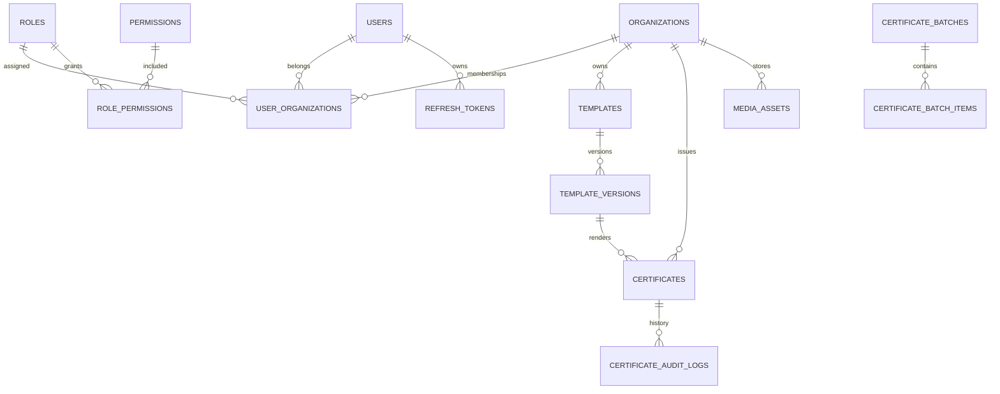

# Database Design

Use PostgreSQL, UUID primary keys, UTC timestamps, foreign keys, indexes, and Flyway migrations. The following is the logical schema; exact column types and constraints should be finalized in migration scripts.

## 1. Tables

### users
- id UUID PK
- full_name VARCHAR(160)
- email VARCHAR(254) UNIQUE
- password_hash TEXT
- status VARCHAR(30)
- created_at TIMESTAMPTZ
- updated_at TIMESTAMPTZ

### organizations
- id UUID PK
- name VARCHAR(200)
- slug VARCHAR(120) UNIQUE
- logo_asset_id UUID NULL
- contact_email VARCHAR(254)
- phone VARCHAR(50)
- address TEXT
- website TEXT
- brand_settings JSONB
- created_at, updated_at TIMESTAMPTZ

### user_organizations
- id UUID PK
- user_id UUID FK users
- organization_id UUID FK organizations
- role_id UUID FK roles
- status VARCHAR(30)
- UNIQUE(user_id, organization_id)

### roles
- id UUID PK
- organization_id UUID NULL
- name VARCHAR(80)
- is_system BOOLEAN

### permissions
- id UUID PK
- code VARCHAR(120) UNIQUE
- description TEXT

### role_permissions
- role_id UUID FK roles
- permission_id UUID FK permissions
- PRIMARY KEY(role_id, permission_id)

### templates
- id UUID PK
- organization_id UUID FK organizations
- name VARCHAR(180)
- description TEXT
- category VARCHAR(80)
- orientation VARCHAR(20)
- page_width NUMERIC(10,2)
- page_height NUMERIC(10,2)
- status VARCHAR(30)
- current_version INTEGER
- created_by UUID FK users
- created_at, updated_at TIMESTAMPTZ

### template_versions
- id UUID PK
- template_id UUID FK templates
- version_number INTEGER
- design_json JSONB
- preview_asset_id UUID NULL
- created_by UUID FK users
- created_at TIMESTAMPTZ
- UNIQUE(template_id, version_number)

### media_assets
- id UUID PK
- organization_id UUID FK organizations
- object_key TEXT UNIQUE
- original_file_name TEXT
- mime_type VARCHAR(120)
- file_size BIGINT
- checksum VARCHAR(128)
- uploaded_by UUID FK users
- created_at TIMESTAMPTZ

### certificates
- id UUID PK
- organization_id UUID FK organizations
- template_id UUID FK templates
- template_version_id UUID FK template_versions
- recipient_name VARCHAR(200)
- recipient_email VARCHAR(254) NULL
- course_name VARCHAR(200)
- certificate_number VARCHAR(100) UNIQUE
- verification_token_hash VARCHAR(128) UNIQUE
- status VARCHAR(30)
- issued_at TIMESTAMPTZ NULL
- expires_at TIMESTAMPTZ NULL
- pdf_object_key TEXT NULL
- png_object_key TEXT NULL
- metadata JSONB
- created_by UUID FK users
- created_at TIMESTAMPTZ

Store a hash of the verification token where practical; the raw token is embedded in the QR URL at issuance and should not be exposed in ordinary API responses.

### certificate_batches
- id UUID PK
- organization_id UUID FK organizations
- template_id UUID FK templates
- template_version_id UUID NULL FK template_versions
- status VARCHAR(30)
- total_records INTEGER
- valid_records INTEGER
- invalid_records INTEGER
- successful_records INTEGER
- failed_records INTEGER
- source_file_asset_id UUID FK media_assets
- source_file_name VARCHAR(255)
- source_headers JSONB
- column_mapping JSONB
- result_zip_object_key TEXT NULL
- idempotency_key VARCHAR(160) NULL
- error_summary TEXT NULL
- created_by UUID FK users
- created_at, completed_at TIMESTAMPTZ

### certificate_batch_items
- id UUID PK
- batch_id UUID FK certificate_batches
- row_number INTEGER
- input_data JSONB
- status VARCHAR(30)
- error_message TEXT NULL
- certificate_id UUID FK certificates NULL
- idempotency_key VARCHAR(160)
- UNIQUE(batch_id, row_number)

### certificate_audit_logs
- id UUID PK
- organization_id UUID FK organizations
- certificate_id UUID NULL FK certificates
- actor_user_id UUID NULL FK users
- action VARCHAR(80)
- reason TEXT NULL
- details JSONB
- created_at TIMESTAMPTZ

### refresh_tokens
- id UUID PK
- user_id UUID FK users
- token_hash TEXT UNIQUE
- expires_at TIMESTAMPTZ
- revoked_at TIMESTAMPTZ NULL
- created_at TIMESTAMPTZ

## 2. Relationships

## 3. Indexes and constraints

- Unique email (case-insensitive strategy recommended).
- Unique organization slug.
- Unique certificate number.
- Unique verification token hash.
- Unique template version number per template.
- Index certificates by `(organization_id, issued_at DESC)`.
- Index certificates by `(organization_id, status)`.
- Index templates by `(organization_id, status)`.
- Index batch items by `(batch_id, status)`.
- Add indexes for commonly searched recipient names and certificate numbers.
- Consider PostgreSQL trigram indexes for recipient search if needed.
- Use soft archive for templates and never hard-delete issued certificate records.

## 4. Multi-organization isolation

All organization-owned records must be scoped by organization ID. The backend must resolve the active organization from the authenticated user's membership and validate access for every read/write. Consider PostgreSQL Row-Level Security as defense in depth, not as a replacement for application authorization.
